# Sensor data Transmission over BLE
## FPB-RA6E2 + DA14531 BLE PMOD + ICM42670/1 Accelerometer

| | |
|---|---|
| **MCU** | R7FA6E2BB3CFM — Cortex-M33 · 200 MHz · RA6E2 |
| **BLE Radio** | DA14531 (US159-DA14531EVZ PMOD) — Bluetooth 5.1, external, GTL over UART |
| **Sensor** | TDK ICM42670/1, I2C |
| **FSP** | v6.5.0 + FreeRTOS |

> **Renesas Electronics — Confidential**
> app_ble_sensor_ra6e2 · FSP v6.5.0 · RA6E2

---

## Table of Contents

1. [Overview](#1-overview)
2. [Key Features](#2-key-features)
3. [Dependencies](#3-dependencies)
   - 3.1 [FPB-RA6E2 Fast Prototyping Board](#31-fpb-ra6e2-fast-prototyping-board)
   - 3.2 [US159-DA14531EVZ BLE PMOD](#32-us159-da14531evz-ble-pmod)
   - 3.3 [TDK ICM42670/1 Accelerometer](#33-tdk-icm426701-accelerometer)
   - 3.4 [Pin Connections](#34-pin-connections)
   - 3.5 [Software Requirements](#35-software-requirements)
   - 3.6 [First-Time vs-code Setup](#36-first-time-vs-code-environment-setup)
4. [FSP Configuration](#4-fsp-configuration)
   - 4.1 [BSP Settings](#41-bsp-settings)
   - 4.2 [FSP Stack Overview](#42-fsp-stack-overview)
   - 4.3 [I2C & IRQ6 Properties](#43-i2c--irq6-properties)
5. [Demo Bring-Up](#5-demo-bring-up)
6. [Usage](#6-usage)
7. [Data Flow Architecture](#7-data-flow-architecture)
   - 7.1 [Project Structure](#71-project-structure)
   - 7.2 [Software-Layer Architecture](#72-software-layer-architecture)
   - 7.3 [FreeRTOS Task Map](#73-freertos-task-map)
      - 7.3.1 [RTOS Task Map (stacks and priorities)](#731-rtos-task-map-stacks-and-priorities)
   - 7.4 [GATT Profile](#74-gatt-profile)
      - 7.4.1 [Units and Data Format](#741-units-and-data-format)
   - 7.5 [Key Functions](#75-key-functions)
   - 7.6 [Public functions — the Three Functions to Reuse](#76-public-functions--the-three-functions-to-reuse)
8. [Runtime Flow](#8-runtime-flow)
   - 8.1 [Boot / Connect / Publish Sequence](#81-boot--connect--publish-sequence)
   - 8.2 [Runtime ODR Change](#82-runtime-odr-change)
   - 8.3 [Changing the ODR from the Phone](#83-changing-the-odr-from-the-phone)
9. [Configuration Parameters](#9-configuration-parameters)
   - 9.1 [Editing the Sensor Data GATT Layout (sensor_data_fields.h)](#91-editing-the-sensor-data-gatt-layout-sensor_data_fieldsh)
10. [Regeneration Safety (QE)](#10-regeneration-safety-qe)
11. [Known Limitations & Open Issues](#11-known-limitations--open-issues)
12. [Integration Notes](#12-integration-notes)
13. [Troubleshooting](#13-troubleshooting)
14. [Summary](#14-summary)
15. [References & Documentation](#15-references--documentation)

---

## 1. Overview

This project streams live 3-axis accelerometer data from a TDK ICM42670/1 sensor over Bluetooth Low Energy, using a Renesas RA6E2 MCU (R7FA6E2BB3CFM, Arm® Cortex®-M33) paired with an external DA14531 BLE radio on a PMOD expansion board. There is no on-chip BLE on the RA6E2 — all BLE stack processing runs on the DA14531, reached over UART using Renesas' GTL (Generic Transport Layer) protocol.

The application is built on Renesas FSP v6.5.0 with FreeRTOS, split across two cooperating threads:

ICM thread (owns I2C, acquisition + publish policy) → event-group signal → BLE thread (owns UART/GTL, GATT dispatch)

Data acquisition is fully interrupt-driven: the ICM42670/1's INT1 data-ready line wakes the ICM thread via an external IRQ, which reads the sample and converts it to milli-g. The same thread then applies a rate limit and a minimum-change threshold, and only a sample that passes both is published — written to the shared struct and announced to the BLE thread through a FreeRTOS event group. The BLE thread applies no policy of its own; on wake it simply pushes the newest sample out as a GATT notification. No fixed polling loop is used anywhere in the data path.

The phone app can also change the accelerometer's sample rate at runtime by writing a dedicated GATT characteristic; the write is validated and handed to the ICM thread, which reconfigures the sensor safely between reads.

---

## 2. Key Features

- **Interrupt-driven acquisition** — ICM42670/1 INT1 → RA6E2 external IRQ, no fixed-cadence polling.
- **Two custom GATT services**: live accelerometer data (Notify) and a runtime sample-rate control (Write).
- **Clean bus-ownership split** — the ICM thread owns I2C and never calls a BLE API; the BLE thread owns UART/GTL and never touches I2C. Acquisition *and* publish policy both live on the ICM thread.
- **Runtime ODR (sample rate) control**, 12–1600 Hz, applied safely from the sensor's own thread.
- **QE-derived GATT profile** (`src/app/ble/*`), now maintained by hand, with the cross-thread glue isolated in `src/`.
- **Rate-limited, threshold-gated publishing** — avoids flooding the DA14531's UART link with a GATT command per raw sample.

| Service | Characteristic | Properties | Payload |
|---|---|---|---|
| Sensor Service | Sensor Data | Notify, CCCD | 6 bytes — X/Y/Z, `int16`, little-endian, milli-g |
| Sensor Write Service | Sensor ODR | Write | 2 bytes — `uint16`, little-endian, Hz |

---

## 3. Dependencies

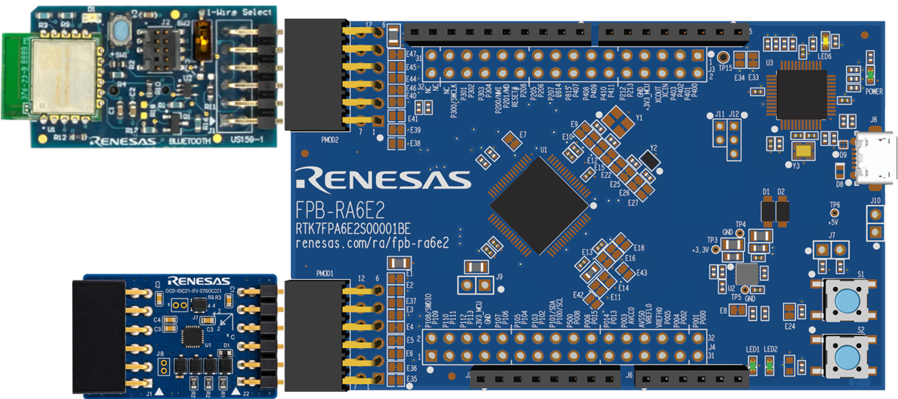

*Figure 1 — FPB-RA6E2 with TDK ICM42670/1 in PMOD1 and US159-DA14531EVZ in PMOD2*

### 3.1 FPB-RA6E2 Fast Prototyping Board

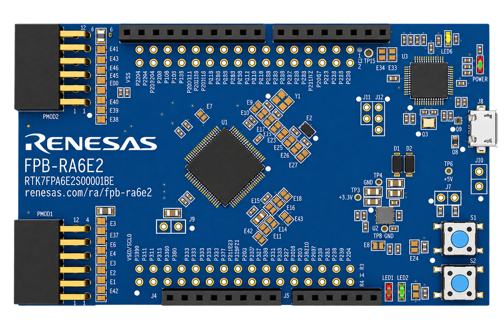

*Figure 2 — FPB-RA6E2*


| Resource | Detail |
|---|---|
| MCU | R7FA6E2BB3CFM — Arm Cortex-M33, 200 MHz |
| Flash / RAM | 256 KB Flash / 40 KB RAM |
| Package | 64-pin LQFP |
| PMOD connectors | ARDUINO/PMOD-compatible expansion, used for both the DA14531 and the ICM42670/1 |
| Debug interface | On-board J-Link (SWD) |

### 3.2 US159-DA14531EVZ BLE PMOD

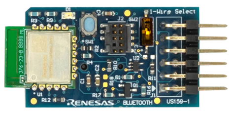

*Figure 3 — US159-DA14531EVZ-front*

| Feature | Detail |
|---|---|
| BLE IC | DA14531 — ultra-low-power Bluetooth 5.1 SoC (formerly Dialog Semiconductor) |
| Firmware | DA14531-00 GTL firmware, ≥ v6.0.23.1451, must be flashed before running the app (not the factory serial-port service) — see [Step 1](#step-1-hardware-setup) |
| Host link | UART, Renesas GTL (Generic Transport Layer) protocol |
| UART channel | SCI0 |
| Boot mode | Boots from its own on-board flash image (`BLE_CFG_HOST_BOOT_MODE=0`) — not host-loaded. The host's `RM_BLE_ABS_Open` can lose a race against `DEVICE_READY_IND` on a fast cold boot; there is no retry, so reset if the board never advertises |
| Advertising | Legacy advertising via `RM_BLE_ABS_StartLegacyAdvertising()` |

### 3.3 TDK ICM42670/1 Accelerometer

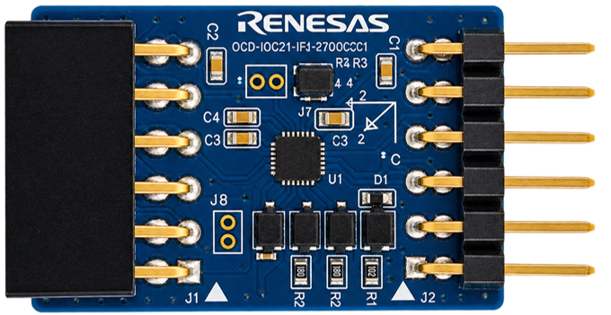

*Figure 4 — TDK sensor*

The ICM42670/1 is a 6-axis MEMS accelerometer/gyroscope (accelerometer channel used here) with a digital I2C interface. It outputs 16-bit signed acceleration data per axis — no analog voltage or ADC sampling is involved.

| Feature | Detail |
|---|---|
| Interface | I2C, slave address `0x68` |
| I2C stack | `g_i2c_master0` (r_iic_b_master, channel 0) → `g_comms_i2c_bus1` → `g_comms_i2c_device1` |
| Output | 3-axis acceleration, `int16` per axis, converted to milli-g |
| Data-ready signaling | INT1 pin → P301 → RA6E2 external IRQ channel 6 (`g_external_irq6_pmod1`) — interrupt-driven, not polled |
| Sample rate (ODR) | Runtime-configurable, 12–1600 Hz, via `RM_ICM42670_DeviceInterruptCfgSet()` / `MeasurementStart()` reconfiguration |
| Driver | Custom vendor-style driver, `src/app/rm_icm42670/` — plain source files, not a Smart Configurator–managed stack |

### 3.4 Pin Connections

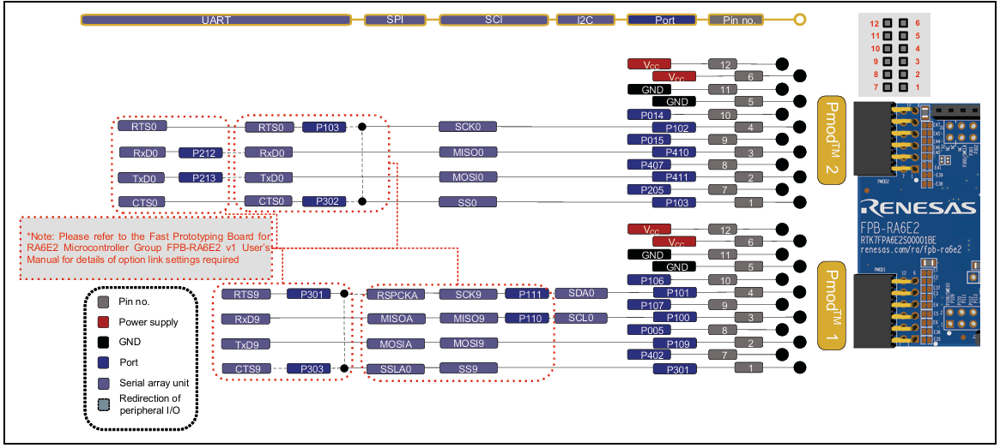

*Figure 5a — FPB-RA6E2 Pmod Interface*

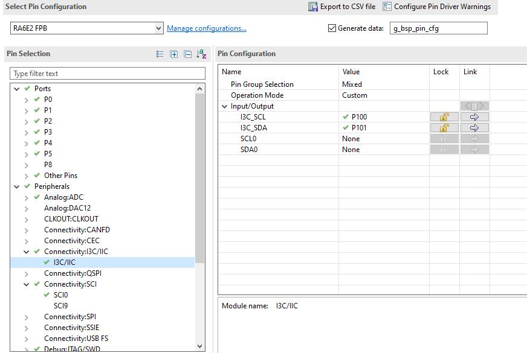

*Figure 5b — PIN assignment I3C*

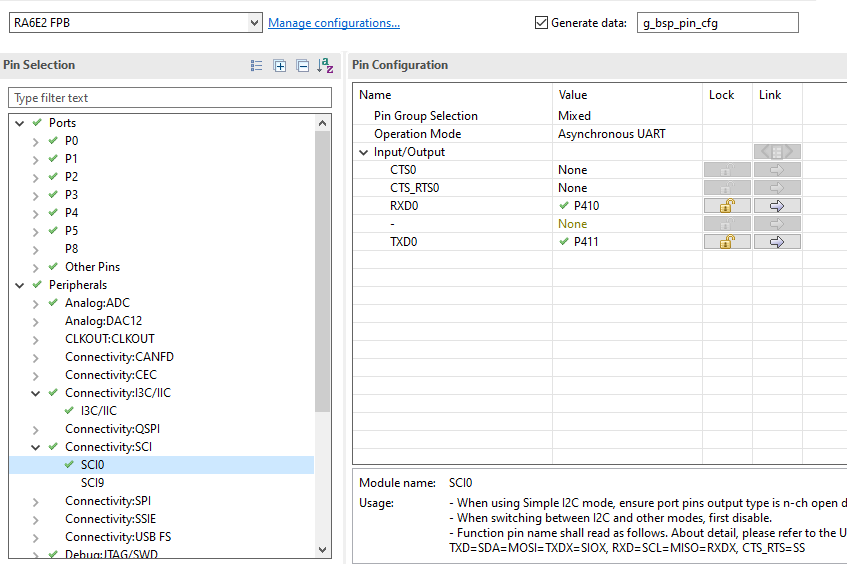

*Figure 5c — PIN assignment UART*

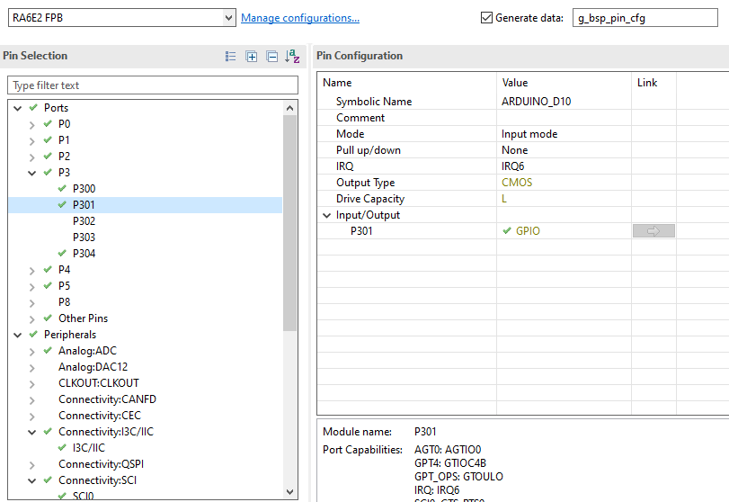

*Figure 5d — PIN assignment IRQ*

| Signal | FPB-RA6E2 Pin | Function |
|---|---|---|
| DA14531 TX (GTL) | RXD0 (SCI0) | UART receive from DA14531 |
| DA14531 RX (GTL) | TXD0 (SCI0) | UART transmit to DA14531 |
| DA14531 RESET | P109 (PIN_07) | Hardware reset line |
| ICM42670/1 SDA/SCL | IIC_B0 (I2C channel 0) | I2C bus to the accelerometer |
| ICM42670/1 INT1 | P301 → ICU IRQ6 | Data-ready interrupt |

### 3.5 Software Requirements

| Software | Version / Notes |
|---|---|
| Renesas e² studio | Compatible with FSP v6.5.0 |
| Renesas FSP | v6.5.0 |
| RTOS | FreeRTOS |
| Debug / Flash | J-Link On-Board (on FPB boards) |

### 3.6 First-Time vs-code Environment Setup

The vs-code / CMake build (`CMakeLists.txt`, `Config.cmake`, `cmake/llvm.cmake`,
`cmake/gcc.cmake`) reads the toolchain locations from environment variables, so the
project builds without editing any tracked file, on any machine or workspace:

| Variable | Tool | Used for | Required? |
|---|---|---|---|
| `ARM_TOOLCHAIN_PATH` | LLVM (ATfE) `bin` folder (contains `clang`, `ld.lld`, `llvm-*`) | Compiling and linking with the ARM LLVM (ATfE) kits | Yes, for the LLVM kits |
| `ARM_GCC_TOOLCHAIN_PATH` | Arm GNU Embedded `bin` folder | Compiling and linking with the ARM GCC kits; also clangd's `--query-driver` | Yes, for the GCC kits |
| `ARM_GDB_PATH` | `arm-none-eabi-gdb` | Hardware debugging | Only for debugging |
| `NINJA_PATH` | Ninja `bin` folder | Building via the Ninja generator | Yes, if using a Ninja kit |
| `RASC_EXE_PATH` | RA Smart Configurator executable | Regenerating FSP content during the build | Optional — `Config.cmake` auto-detects it under the common per-OS RASC install roots if unset |

Set these once per machine (shell profile on Linux, System Environment Variables on
Windows), then select a kit in vs-code's CMake extension — ARM LLVM (ATfE) - Ninja
is the default for this project. No administrator/root rights are required.

> **IMPORTANT:** After setting the variables, close and re-open vs-code so it
> picks them up.

e² studio does not use these variables — it resolves its toolchains through its own
Renesas Toolchain Management registration instead.

---

## 4. FSP Configuration

FSP configuration is done with e² studio / Renesas Smart Configurator (RASC). Refer to the Renesas e² studio User Guide for general project-generation steps.

### 4.1 BSP Settings

| Setting | Value |
|---|---|
| FSP Version | 6.5.0 |
| Board | FPB-RA6E2 |
| Device | R7FA6E2BB3CFM · Cortex-M33 |
| RTOS | FreeRTOS |

### 4.2 FSP Stack Overview

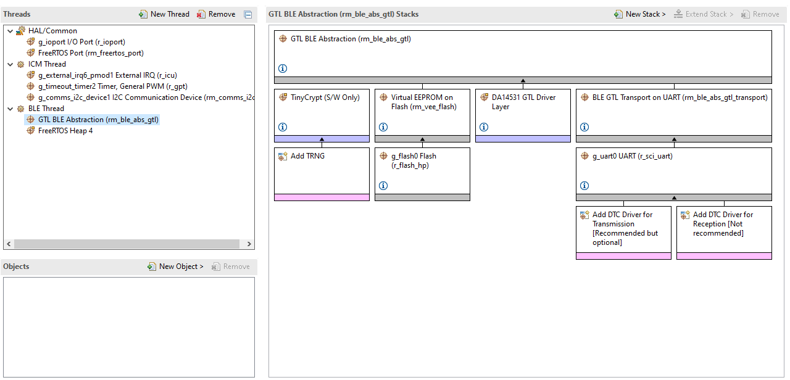

*Figure 6a — FSP BLE STACK*

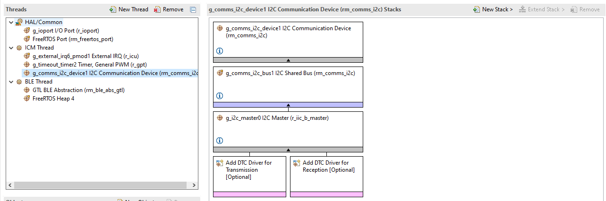

*Figure 6b — FSP I2C STACK*

| FSP Module | Instance | Role |
|---|---|---|
| `g_ble_abs0` (RM_BLE_ABS, GTL) | — | BLE stack transport to the external DA14531 over UART (SCI0) |
| `g_i2c_master0` (r_iic_b_master, channel 0) | — | I2C master HAL underlying the ICM42670/1 comms stack |
| `g_comms_i2c_bus1` / `g_comms_i2c_device1` (rm_comms_i2c) | — | I2C bus/device wrapper; slave address `0x68`, callback `rm_icm42670_comms_i2c_callback` |
| `g_external_irq6_pmod1` (r_icu, channel 6) | — | External IRQ on P301 — ICM42670/1 INT1, routed to `rm_icm42670_irq_callback` |
| QE-derived BLE profile (`src/app/ble/*`) | — | GATT server: attribute table, `app_main.c` (GAP/GATT event dispatch), `gatt_db.h`. Service APIs live in `src/rs_ble_SensorServices.c` and `src/rs_ble_SensorRates.c` |
| `rm_icm42670` (custom driver, `src/app/rm_icm42670/`) | — | ICM42670/1 register-level driver: Open, DeviceInterruptCfgSet, MeasurementStart, AccelRead/AccelDataCalculate, ODR reconfiguration |

### 4.3 I2C & IRQ6 Properties

**I2C (`g_i2c_master0` / `g_comms_i2c_bus1`)**

| Property | Value |
|---|---|
| Channel | IIC_B0 (channel 0) |
| Slave address | `0x68` |
| Address mode | 7-bit |

**External IRQ6 (`g_external_irq6_pmod1`)**

| Property | Value |
|---|---|
| Channel | 6 |
| Pin | P301 |
| Source | ICM42670/1 INT1 (data-ready) |

---

## 5. Demo Bring-Up

### Step 1: Hardware Setup

1. Seat the US159-DA14531EVZ BLE PMOD on the designated FPB-RA6E2 PMOD2 connector.
2. Before running the app, program the DA14531 module with the required DA14531-00 GTL firmware (≥ v6.0.23.1451). Follow the official flashing procedure here: [DA14531 Firmware Upgrade — Programming Procedure](https://www.renesas.com/en/software-tool/smartbond-flash-programmer#downloads).
3. Connect the ICM42670/1 breakout to PMOD1.
4. Connect the FPB-RA6E2 to your PC via the on-board USB connector.

### Step 2: Add Project to IDE

> **Note:** Use section A for e² studio and section B for vs-code

### Step 2.A: Import the Project into e² studio

1. Launch e² studio and select a workspace path with no spaces.
2. **File → Import → General → Existing Projects into Workspace → Next**.
3. Browse to `examples/ra6e2/fpb-ra6e2` and finish the import.

### Step 2.B: Open Project into vs-code

1. Launch vs-code and File → Open Folder.
2. Navigate to `examples/ra6e2/fpb-ra6e2`. Click Select Folder.
3. On the popup window, select ARM LLVM (ATfE) Ninja LLVM-embedded-toolchain-for-Arm (clang) with Ninja.
4. The default build configuration is Debug, and this is the one you need.

### Step 3: Review FSP Configuration

Open `configuration.xml` in the RA Configuration view and confirm: BSP tab (device R7FA6E2BB3CFM, FSP 6.5.0), Stacks tab (BLE ABS + I2C + external IRQ6), and Pins tab (SCI0, IIC_B0, P301/IRQ6).

### Step 4: Build

> **Note:** Use section A for e² studio and section B for vs-code

### Step 4.A: Build e² studio
1. Confirm the active build configuration is Debug.
2. Press Ctrl+B or right-click the project → Build Project.
3. A successful build prints zero errors:

```
**** Incremental Build of configuration Debug ****
   text    data     bss     dec     hex filename
  62636     160   15157   77953   13081 Sensor_data_Transmission_over_BLE.elf
Build Finished. 0 errors, 0 warnings.
```

Output files are written to `Debug/`: `Sensor_data_Transmission_over_BLE.elf` · `.srec` · `.map`

### Step 4.B: Build vs-code
1. Press the Build icon on the bottom bar, or the Build button in the CMake tool on the right panel.
2. A successful build prints zero errors:

```
 [build] [89/89 100% :: 26.089] Linking C executable <...>.elf
 [driver] Build completed: 00:00:26.473
 [build] Build finished with exit code 0
```

Output files are written to `build/Debug/`: `fpb-ra6e2.elf` · `.srec` · `.map`

### Step 5: Flash & Run

> **Note:** Use section A for e² studio and section B for vs-code

### Step 5.A: Flash & Run e² studio

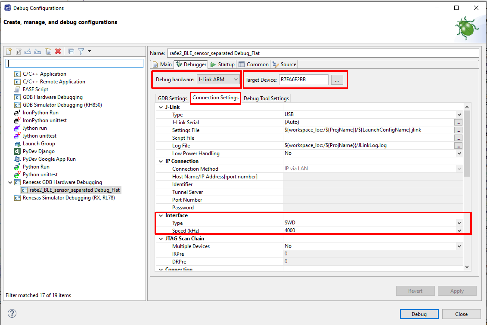

*Figure 7a — Debug Config*

1. Start a debug session (Renesas GDB Hardware Debugging) and download to the board.
2. Resume execution. On a free-running boot the DA14531 begins advertising after its `DEVICE_READY_IND` handshake.

Call chain at boot:
```
main()                                  ← FSP generated
├─ ble_thread_entry()                   ← runs app_main() / BLE stack
│  └─ ble_init()                        ← RM_BLE_ABS_Open, GATT service init
└─ icm_thread_entry()                   ← sensor_main(): icm42670_init() (I2C + sensor init),
                                           then the acquisition loop
```
### Step 5.B: Flash & Run vs-code

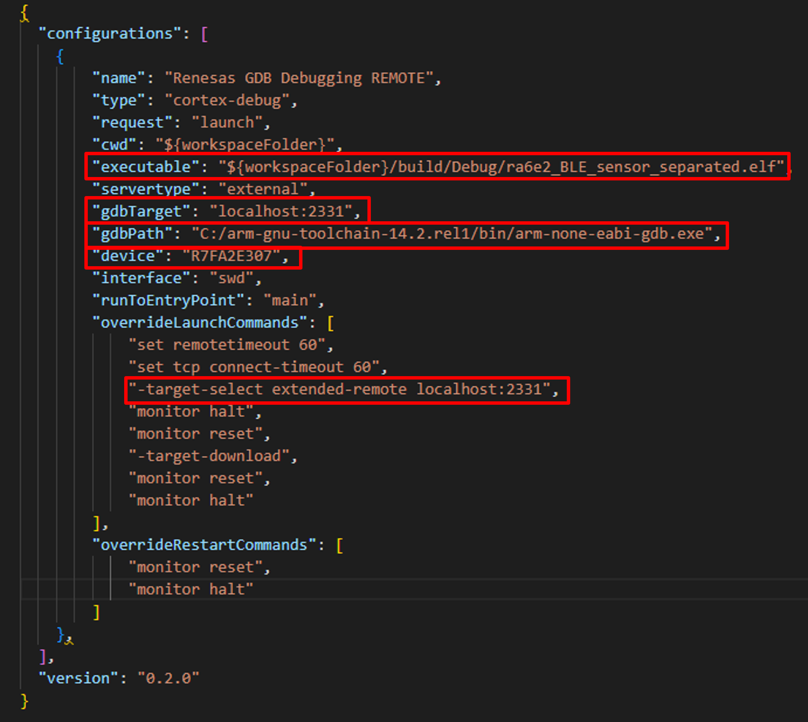

*Figure 7b — Debug Config*

1. Confirm the micro-USB cable is connected to J10 and the board is powered.
2. Press Ctrl+Shift+D to open Run and Debug, then configure the launch.json file.
3. Set the following:
   1) For "executable" Set ELF file path
   2) For "gdbTarget" set remote IP:GDB port
   3) For "gdbPath" Set GDB path
   4) For "device" Set target device ("R7FA6E2BB3CFM")
   5) For "-target-select extended-remote localhost:2331" Set remote IP:GDB port
4. Click the Start Debugging icon; vs-code downloads the `.elf` to the FPB-RA6E2 via J-Link and halts at `main()`.
5. Use the debug icons to debug.

Call chain at boot (same as Step 5.A):
```
main()                                  ← FSP generated
├─ ble_thread_entry()                   ← runs app_main() / BLE stack
│  └─ ble_init()                        ← RM_BLE_ABS_Open, GATT service init
└─ icm_thread_entry()                   ← sensor_main(): icm42670_init() (I2C + sensor init),
                                           then the acquisition loop
```


> **Note:** For integration into your own project or customer hardware, check [Section 12](#12-integration-notes) for the required differences (BSP device selection, pin/channel remap, and stack configuration updates). This Section flow is for running the packaged demo on the reference hardware.

---

## 6. Usage

1. Scan for the device using a BLE client app (e.g. Renesas SmartBond, Renesas GattBrowser).
2. Connect, accept the pairing request (LE Secure Connections, Just Works), then enable notifications on the Sensor Data characteristic (write its CCCD) — the device does not push samples until the client subscribes.
3. Move the board — X/Y/Z acceleration in milli-g streams as Notify packets, rate-limited to roughly 10 Hz with a minimum per-axis change threshold to suppress noise at rest. See [7.4.1 Units and Data Format](#741-units-and-data-format) for what the numbers mean and how to decode the bytes.
4. To change the sample rate, write a 2-byte little-endian `uint16` (Hz, 12–1600) to the Sensor ODR characteristic. The sensor reconfigures within one ICM-thread loop iteration. See [8.3](#83-changing-the-odr-from-the-phone) for the byte values and conversion.

---

## 7. Data Flow Architecture

### 7.1 Project Structure

```
ble_sensor_data_transmission_using_da14531/                      ← repo root
├── README.md                                                    ← this file
├── readme_assets/                                                ← Figures used by this README
├── src/
│   ├── sensor_data_fields.h
│   ├── rs_ble_sensor_data_tx.c/.h           ← Cross-thread glue
│   ├── rs_ble_SensorServices.c/.h
│   └── rs_ble_SensorRates.c/.h
└── examples/
    └── ra6e2/fpb-ra6e2/
        ├── src/
        │   ├── icm_thread_entry.c
        │   ├── ble_thread_entry.c
        │   ├── hal_warmstart.c
        │   ├── SEGGER_RTT/               ← SEGGER RTT library behind MSG_PRINT (print/init enabled by RTT_DEBUG_ON)
        │   ├── app/                      ← the portable app sources
        │   │   ├── sensor_main.c
        │   │   ├── sensor_ble_bridge.h
        │   │   ├── rm_icm42670/
        │   │   │   ├── rm_icm42670.c/.h, rm_icm42670_api.h, rm_icm42670_reg.h
        │   │   │   ├── rm_icm42670_cfg.h, rm_icm42670_ra_driver.c
        │   │   │   ├── rm_icm42670_hal_data.c/.h
        │   │   │   └── data_ready_mode/rm_icm42670_data_ready_mode.c
        │   │   └── ble/
        │   │       ├── app_main.c
        │   │       ├── gatt_db.h
        │   │       ├── qe_ble_profile.c/.h
        │   │       └── profile_cmn/, discovery/, r_ble_gapc.*, r_ble_gat2s.*
        │   └── rs_ble_sensor/
        │       ├── rs_ble_sensor_data_tx.c/.h
        │       ├── rs_ble_SensorRates.c/.h
        │       ├── rs_ble_SensorServices.c/.h
        │       └── sensor_data_fields.h
        ├── configuration.xml             ← FSP stack + pin config (open in e² studio / RASC)
        ├── script/fsp.lld                ← Linker script (user-editable, holds the memory layout)
        ├── e² studio build config
        └── CMake / vs-code build config
```

> **Not in git — generated locally:** `ra/`, `ra_gen/`, `ra_cfg/` (FSP + CMSIS + FreeRTOS + the vendor BLE middleware `r_ble_gtl.c`, plus all generated config), `fsp_gen.lld` / `memory_regions.lld`, `bsp_linker_info.h`, `buildinfo.json`, `compile_commands.json` and `.clangd` are all gitignored. They are reproduced from `configuration.xml` by "Generate Project Content", which runs automatically on a fresh clone: e² studio does it on project import / build ([Step 2.A](#step-2a-import-the-project-into-e²-studio)), and the CMake build invokes RASC from `cmake/prebuild.cmake` before compiling ([Step 4.B](#step-4b-build-vs-code)). Never edit them by hand; the next generation overwrites them.

### 7.2 Software-Layer Architecture

| Layer | Main responsibility | Key files |
|---|---|---|
| ICM thread | Sensor acquisition — I2C read, mg conversion, and all publish policy (rate limit, threshold) | `src/app/sensor_main.c` |
| Glue (RS) | Cross-thread handoff: `rs_ble_sensor_tx()`/`rs_ble_sensor_sample()`, `rs_sensor_sample_t`, `g_sensor_accel_sample` | `src/rs_ble_sensor/rs_ble_sensor_data_tx.c/.h` (copy of the repo-root `src/`) |
| BLE thread | GATT server, GAP/advertising/pairing, notify dispatch | `src/app/ble/app_main.c` |
| Vendor middleware | GTL protocol over UART to the DA14531 | `ra/renesas/wireless/da14xxx/r_ble_gtl/r_ble_gtl.c` |
| Hardware | RA6E2 + DA14531 + ICM42670/1 | Physical boards |

**Call flow (top-down)**

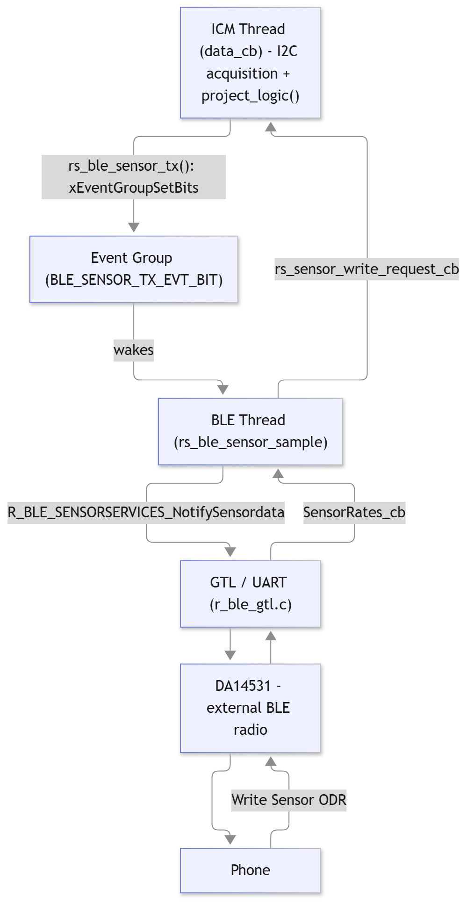

### 7.3 FreeRTOS Task Map

| Task | Owns | Role |
|---|---|---|
| ICM thread (`sensor_main()`, called from `icm_thread_entry.c` stub) | I2C bus (IIC_B0), ICM42670/1 | Blocks on a data-ready semaphore given from the INT1 ISR; on wake, reads and converts one sample, runs `project_logic()`, and only if it passes writes the shared sample struct and sets `BLE_SENSOR_TX_EVT_BIT`; applies pending ODR changes at the top of its loop |
| BLE thread (`ble_thread_entry` → `app_main()`) | UART/GTL, GATT server | Runs `R_BLE_Execute()` / GAP-GATT event dispatch (incl. the pairing-request override); wakes on either a GTL event or `BLE_SENSOR_TX_EVT_BIT`; on wake, calls `rs_ble_sensor_sample()` to notify |

See [7.3.1](#731-rtos-task-map-stacks-and-priorities) for stack sizes and priorities.

**Cross-thread handoff:**

- `g_sensor_accel_sample` — written by the ICM thread, read by the BLE thread, intentionally unsynchronized (no mutex). A torn read is an accepted, self-correcting glitch on telemetry data; see the comment in `src/rs_ble_sensor/rs_ble_sensor_data_tx.h`, where both it and `rs_sensor_sample_t` are declared.
- `BLE_SENSOR_TX_EVT_BIT` — a single bit OR'd into the same FreeRTOS event group the BLE thread already blocks on for GTL events, so no extra RTOS object is needed. Bits coalesce: a busy BLE thread simply sees the newest sample rather than every one.
- ODR write request — a plain `volatile` value + pending flag, written by the BLE thread (`rs_sensor_write_request_cb()`) and consumed only by the ICM thread (which exclusively owns the I2C bus).

#### 7.3.1 RTOS Task Map (stacks and priorities)

Every task in the running system, who creates it, its stack size, priority and role. A higher number means a higher priority (`configMAX_PRIORITIES` = 5).

| Task | Created by | Stack | Priority | Role |
|---|---|---|---|---|
| `BLE Thread` | FSP (static, `ra_gen/ble_thread.c`) | 1 KB (1024 B) | 2 | Calls `ble_thread_entry()` → `app_main()`: runs `R_BLE_Execute()` and the GAP/GATT event dispatch; wakes on a GTL event or `BLE_SENSOR_TX_EVT_BIT` and sends the notification |
| `ICM Thread` | FSP (static, `ra_gen/icm_thread.c`) | 768 B | 1 | Calls `icm_thread_entry()` → `sensor_main()`: waits on the data-ready semaphore, reads and converts a sample, runs `project_logic()`, applies pending ODR changes |
| `Tmr Svc` | FreeRTOS kernel (`configUSE_TIMERS` = 1) | 512 B (128 words) | 3 | FreeRTOS software-timer service |
| `IDLE` | FreeRTOS kernel | 512 B (128 words) | 0 | FreeRTOS idle task |

**Notes**

- All four tasks use static allocation: the thread stacks are created by `xTaskCreateStatic`, and the idle and timer stacks come from the `vApplicationGet…TaskMemory()` hooks in `ra_gen/main.c`. Sizes are passed to FreeRTOS in words (bytes ÷ 4).
- The BLE thread has a higher priority than the ICM thread, so a pending BLE event is serviced before the next sensor read.
- The project creates no other tasks.
- Stack sizes are the configured values. Actual stack usage has not been measured.

**Total stack budget:** 1024 + 768 + 512 + 512 = 2816 B (2.75 KB). Other settings: tick rate 1000 Hz, FreeRTOS heap 2 KB (`configTOTAL_HEAP_SIZE` = `0x800`).

### 7.4 GATT Profile

| Service | Characteristic | Properties | Length | Notes |
|---|---|---|---|---|
| Sensor Service | Sensor Data | Notify, CCCD | 6 bytes | Notify-only — no Read or Write on the value itself; the CCCD descriptor is what the client writes to subscribe |
| Sensor Write Service | Sensor ODR | Write | 2 bytes | Little-endian `uint16` Hz; out-of-range writes (outside 12–1600 Hz) are silently rejected |

#### 7.4.1 Units and Data Format

The Sensor Data characteristic carries three values per notification, in this order: X, Y, Z.

| Property | Value |
|---|---|
| Size | 6 bytes (3 × 2 bytes) |
| Format | signed 16-bit integer (`int16`), little-endian |
| Unit | milli-g (mg) — one thousandth of a g |
| Range | ±2000 mg (sensor set to ±2 g) |

**What is "g"?** g is a unit of acceleration (not a gram). 1 g is the acceleration of Earth's gravity, 9.80665 m/s²:

| g | mg | m/s² |
|---|---|---|
| 1 g | 1000 mg | ≈ 9.8 |
| 0.5 g | 500 mg | ≈ 4.9 |
| 2 g | 2000 mg | ≈ 19.6 |

**What you should see**

- A board lying flat and still reads about +1000 on Z and close to 0 on X and Y. An accelerometer measures the push opposing gravity, so Z is *positive* when it points up.
- Upside down, Z reads about −1000.
- Tilting moves gravity between the axes, but the total
  √(X² + Y² + Z²) stays near 1000 mg while the board is still.
- Shaking or moving the board adds to these values. Anything above 2 g is clipped at about ±2000 mg.
- Resting values can differ from the ideal by a few percent (sensor offset and gain tolerance).

**Reading the bytes.** Each axis is two bytes, low byte first, read as a *signed* number. Example notification `1D 00 B8 FF F8 03`:

| Axis | Bytes | Value |
|---|---|---|
| X | `1D 00` | +29 mg |
| Y | `B8 FF` | −72 mg |
| Z | `F8 03` | +1016 mg (≈ 1.02 g) |

To convert to m/s², multiply by 9.8 / 1000 (e.g. 1016 mg ≈ 9.96 m/s²).
If you read the values as *unsigned*, negative readings show up as large numbers
(e.g. −72 appears as 65464) — make sure the app treats them as signed 16-bit.

**Notification rate.** A sample is only sent if at least one axis differs from the last *sent* value by
`BLE_ICM_SENSOR_SENSITIVITY_THRESHOLD_MG` (default 15 mg; the same threshold applies to each axis, and all three
axes are sent together), and at most about every `BLE_ICM_UPDATE_INTERVAL_MS`. A completely still board
therefore stops sending updates; this is expected, not a fault.

### 7.5 Key Functions

| Function | File | Role |
|---|---|---|
| `sensor_main()` | `src/app/sensor_main.c` | ICM thread body: calls `icm42670_init()`, then loops on the data-ready semaphore |
| `init_i2c_comm()` | `src/app/sensor_main.c` | Opens the I2C comms bus/device stack for the ICM42670/1 |
| `icm42670_init()` | `src/app/sensor_main.c` | Creates the data-ready semaphore, opens the I2C bus (`init_i2c_comm()`), opens the ICM42670/1, arms INT1 and starts measurement. Any failure stops at `__BKPT(0)` (with a `[FAIL]` RTT message when `RTT_DEBUG_ON` is defined) |
| `data_cb()` | `src/app/sensor_main.c` | Acquisition: I2C read on data-ready, converts to milli-g, runs `project_logic()`, and on pass calls `rs_ble_sensor_tx()` |
| `app_icm_drdy_isr_signal()` | `src/app/sensor_main.c` | ISR-context signal from the INT1/IRQ6 callback |
| `project_logic()` | `src/app/sensor_main.c` | All publish policy: rate limit, minimum-change threshold — runs on the ICM thread, before a sample ever reaches the BLE thread |
| `icm_odr_apply_pending()` | `src/app/sensor_main.c` | Applies a pending runtime ODR change at the top of the ICM loop, where the I2C bus is safely owned |
| `rs_ble_sensor_tx()` | `src/rs_ble_sensor/rs_ble_sensor_data_tx.c` | Called from the ICM thread: stores the sample and sets `BLE_SENSOR_TX_EVT_BIT` to wake the BLE thread |
| `rs_ble_sensor_sample()` | `src/rs_ble_sensor/rs_ble_sensor_data_tx.c` | Called from the BLE thread on wake: reads the shared sample and pushes the GATT notify |
| `rs_sensor_write_request_cb()` | `src/app/sensor_main.c` | Records a runtime ODR change requested from the BLE thread; validated 12–1600 Hz |
| `ble_init()` | `src/app/ble/app_main.c` | `RM_BLE_ABS_Open` then GATT DB / server / client / service init. Single attempt — returns `BLE_ERR_INVALID_OPERATION` on any failure; the `app_main()` call site traps it with `__BKPT(0)` (debugger halt), same convention as the ICM-thread init checks |
| `app_main()` | `src/app/ble/app_main.c` | BLE thread main loop: `R_BLE_Execute()` plus the event-group wait that also wakes on `BLE_SENSOR_TX_EVT_BIT` |
| `SensorRates_cb()` | `src/app/ble/app_main.c` | Service callback fired on a Sensor ODR write; forwards to `rs_sensor_write_request_cb()` |
| `SensorServices_cb()` | `src/app/ble/app_main.c` | Service callback for the Sensor Data characteristic (CCCD subscribe/unsubscribe) |
| `gap_cb()`'s `BLE_GAP_EVENT_PAIRING_REQ` case | `src/app/ble/app_main.c` | Forces LE Secure Connections and accepts the phone's pairing request (DA14531 Secure-Connections pairing fix) |
| `R_BLE_SENSORSERVICES_NotifySensordata()` | `src/rs_ble_sensor/rs_ble_SensorServices.c` | Encodes `st_ble_sensorservices_sensordata_t` and sends the GATT notification |

### 7.6 Public functions — the Three Functions to Reuse

If you are lifting the RS side into a different project, these three `rs_` functions are the entire seam between your sensor code and the BLE side. Everything else in the RS is internal.

Paths below are given as the repo-root RS (`src/`, the source of truth); inside this project the same files are at `examples/ra6e2/fpb-ra6e2/src/rs_ble_sensor/`.

| Function | Implemented by | Called from |
|---|---|---|
| `rs_ble_sensor_tx()` | RS — `src/rs_ble_sensor_data_tx.c` | your sensor thread |
| `rs_ble_sensor_sample()` | RS — `src/rs_ble_sensor_data_tx.c` | the BLE thread's main loop |
| `rs_sensor_write_request_cb()` | you — `src/app/sensor_main.c` in this project | the BLE thread, from `SensorRates_cb()` |

All three are declared in `rs_ble_sensor_data_tx.h`.

**`void rs_ble_sensor_tx(rs_sensor_sample_t sample)`** — the publish half. Call it from your sensor thread once you have a sample worth sending. It copies the sample into the global `g_sensor_accel_sample` and sets `BLE_SENSOR_TX_EVT_BIT` on the BLE thread's event group. It does not notify — it only wakes the BLE thread. Rate limiting and filtering are your job *before* this call; whatever reaches it gets published.

**`ble_status_t rs_ble_sensor_sample(rs_sensor_sample_t sample)`** — the notify half, running on the BLE thread. Note the sample arrives as an argument, not read from the global internally; the call site is `rs_ble_sensor_sample(g_sensor_accel_sample)` in `app_main.c`. It maps the fields onto the GATT struct via the `sensor_data_fields.h` X-macro and calls `R_BLE_SENSORSERVICES_NotifySensordata()`. A `BLE_ERR_INVALID_OPERATION` return normally just means the peer has not subscribed to the CCCD — expected, not a fault.

**`void rs_sensor_write_request_cb(uint16_t value)`** — the inbound half, and the one that catches people out: RS *declares* it but never defines it. Your application must supply it, or the link fails with an undefined reference. RS calls it on the BLE thread when the phone writes the control characteristic, handing over the raw little-endian value straight off the wire. Validate it yourself, and defer the actual hardware work to your own thread — the BLE thread must not touch your sensor bus. Here it range-checks 12–1600 Hz, sets a pending flag, and lets the ICM thread do the reconfiguration.

> **Naming:** `_tx` is the sensor→BLE handoff while `_sample` is the actual GATT send, which reads backwards. Both names are load-bearing across `src/app/` and `src/` — don't rename one without the other.

**Minimum port:** implement `rs_sensor_write_request_cb()`; call `rs_ble_sensor_tx()` from your acquisition thread; call `rs_ble_sensor_sample(g_sensor_accel_sample)` from the BLE loop when `BLE_SENSOR_TX_EVT_BIT` is set; declare your fields in `sensor_data_fields.h` (see [§9.1](#91-editing-the-sensor-data-gatt-layout-sensor_data_fieldsh)).

---

## 8. Runtime Flow

### 8.1 Boot / Connect / Publish Sequence

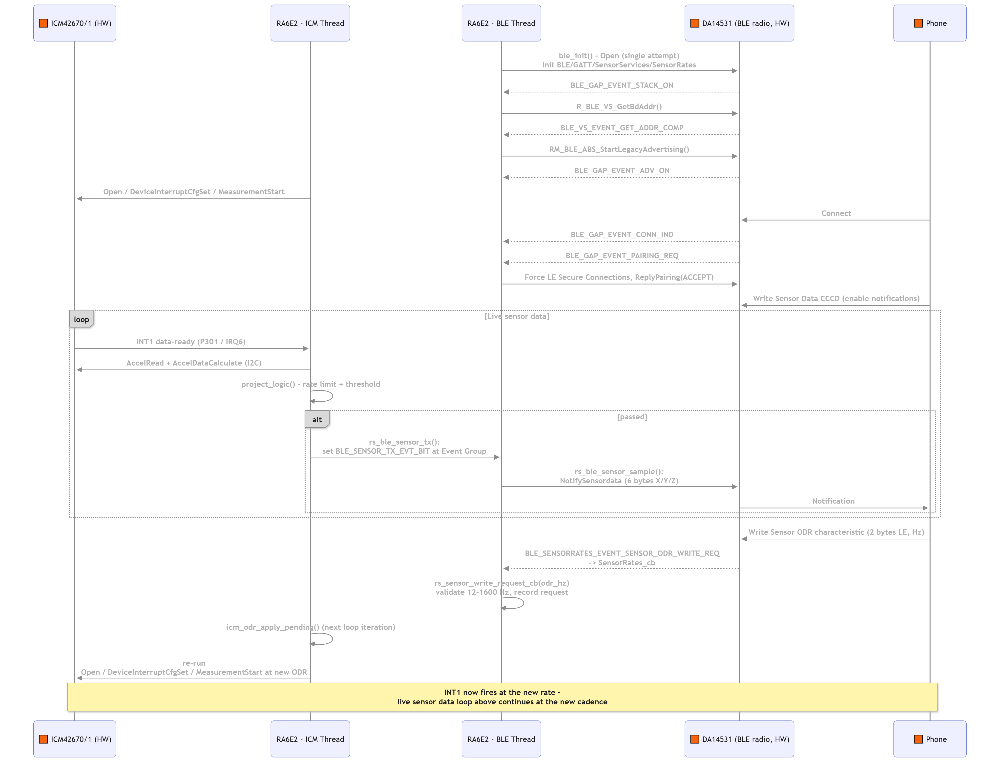

### 8.2 Runtime ODR Change

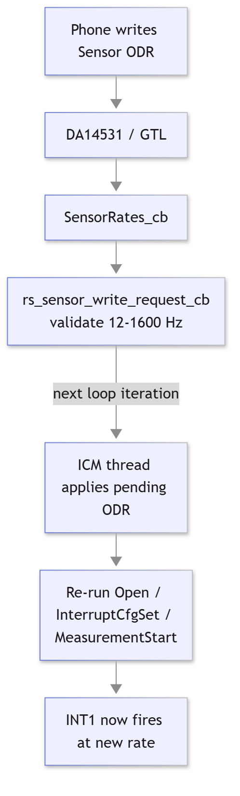

### 8.3 Changing the ODR from the Phone

The sensor's sample rate (ODR) is changed by writing the Sensor ODR characteristic of the Sensor Write Service (see [7.4](#74-gatt-profile)).

Exactly 2 bytes should be written: the ODR in Hz as a 16-bit unsigned integer, low byte first (little-endian). The valid range is 12–1600 Hz.

**Converting Hz to the bytes to enter**

1. Convert the ODR in Hz to a 16-bit hex number, for example 400 Hz → `0x0190`.
2. Swap the two bytes: `0x0190` → `90 01`.
3. Enter `90 01` in the app's hex field. If your app can write a little-endian `uint16` directly, enter the decimal Hz value instead.

| ODR | Hex | Bytes to enter |
|---|---|---|
| 12 Hz | `0x000C` | `0C 00` |
| 25 Hz | `0x0019` | `19 00` |
| 50 Hz | `0x0032` | `32 00` |
| 100 Hz (power-up default) | `0x0064` | `64 00` |
| 200 Hz | `0x00C8` | `C8 00` |
| 400 Hz | `0x0190` | `90 01` |
| 800 Hz | `0x0320` | `20 03` |
| 1600 Hz | `0x0640` | `40 06` |

**What the sensor actually uses.** The driver supports only the eight rates in the table and rounds any other value up to the next one: 13–25 → 25, 26–50 → 50, 51–100 → 100, 101–200 → 200, 201–400 → 400, 401–800 → 800, 801–1600 → 1600. For example, 150 Hz (`96 00`) makes the sensor run at 200 Hz.

**Writes that are ignored.** A value below 12 or above 1600 Hz (for example `00 00`, or 2000 Hz = `D0 07`) and a write that is not exactly 2 bytes are ignored: the ODR stays unchanged and the phone gets no error.

**Notes**

- The characteristic is write-only, so the current ODR cannot be read back.
- The ODR is not stored. After a reset the sensor returns to the compile-time default (100 Hz).
- On a valid write the ICM thread closes and reopens the sensor at the new rate; no samples are produced during the switch.

---

## 9. Configuration Parameters

| Parameter | File | Purpose |
|---|---|---|
| `ENABLE_SENSOR_EVT_TO_BLE` | `app/ble/app_main.c` | Set to 0 to compile out the ICM→GATT publish path in the main loop and in `rs_ble_sensor_sample()` |
| `BLE_ICM_UPDATE_INTERVAL_MS` / `BLE_ICM_SENSOR_SENSITIVITY_THRESHOLD_MG` (default `15`) | `app/sensor_main.c` | Rate limit (~10 Hz) and minimum per-axis change (milli-g) before a sample is notified. Default `15` is high sensitivity to axis movement; raise it (e.g. `500`) for low sensitivity |
| `ICM_DRDY_TIMEOUT_PERIODS` / `ICM_DRDY_TIMEOUT_MIN_MS` / `ICM_DRDY_TIMEOUT_MAX_MS` | `app/sensor_ble_bridge.h` | Safety-net timeout on the data-ready semaphore wait (missed/lost edge only): ICM_DRDY_TIMEOUT_PERIODS sample periods at the current ODR, clamped to limits derived from `ICM_ODR_MAX_HZ` / `ICM_ODR_MIN_HZ` (3–333 ms) |
| `ICM_ODR_MIN_HZ` / `ICM_ODR_MAX_HZ` | `app/sensor_ble_bridge.h` | Valid runtime ODR range accepted from the phone |
| Compile-time ODR | `app/rm_icm42670/rm_icm42670_hal_data.c` (`.accel_odr`) | Sensor's power-up sample rate before any runtime write |

### 9.1 Editing the Sensor Data GATT Layout (sensor_data_fields.h)

[`src/rs_ble_sensor/sensor_data_fields.h`](src/rs_ble_sensor/sensor_data_fields.h) is the single place to add, remove, or rename the fields carried in the Sensor Data notification (X/Y/Z by default).

It defines one X-macro list:

```c
#define BLE_SENSORSERVICES_SENSORDATA_FIELDS(X) \
    X(sensor_x) \
    X(sensor_y) \
    X(sensor_z)
```

Everything downstream derives from this list instead of being hand-maintained separately:

| Derived from the list | Where |
|---|---|
| `BLE_SENSORSERVICES_SENSORDATA_LEN` (byte length = 2 × field count) | `src/rs_ble_sensor/sensor_data_fields.h` (consumed via `gatt_db.h`) |
| `st_ble_sensorservices_sensordata_t` struct fields, plus a `_Static_assert` that its size matches the wire length | `src/rs_ble_sensor/rs_ble_SensorServices.h` |
| `.value_length` / `.value` sizing of the GATT DB entry (handle 14) | `src/app/ble/qe_ble_profile.c` |
| encode/decode (a plain `memcpy` of `BLE_SENSORSERVICES_SENSORDATA_LEN` bytes) | `src/rs_ble_sensor/rs_ble_SensorServices.c` |

**To add a field:**

1. Add one line to the `X(...)` list in `sensor_data_fields.h`, e.g. `X(sensor_w)`. The characteristic length, struct, GATT DB entry, and encode/decode all update automatically at compile time — none of the four files above need editing.
2. Every field must be `uint16_t`. The encode/decode path is a raw `memcpy`, which only produces the correct little-endian wire format if the struct is a flat, unpadded array of `uint16_t` — adding a different-sized type (e.g. `uint8_t` or `uint32_t`) risks introducing struct padding that silently corrupts the notified payload.
3. This file only controls the GATT wire layout and the handoff struct - it has no idea where a field's
   value comes from. `rs_sensor_sample_t` (`rs_ble_sensor_data_tx.h`) and the copy into the GATT struct in
   `rs_ble_sensor_sample()` (`rs_ble_sensor_data_tx.c`) are generated from the same list, so neither needs editing.
   To populate the new field with real sensor data:
   - Set it in `data_cb()` in `src/app/sensor_main.c`, e.g. `accel_sample.sensor_w = ...`. Until you do, it
     holds an uninitialized value.
   - `project_logic()` (same file) only looks at x/y/z for the rate-limit and threshold check. Update it only if the new field should affect that decision.

---

## 10. Regeneration Safety (QE)

> **QE is no longer used in this project's ongoing workflow** (see [§12](#12-integration-notes)) — the GATT profile is now maintained by hand, and field-list changes to the Sensor Data characteristic go through [`sensor_data_fields.h`](#91-editing-the-sensor-data-gatt-layout-sensor_data_fieldsh) instead. This section is kept as historical context for *why* the code is laid out this way.

`src/app/ble/app_main.c` (as seen through the `app` link) was originally QE-generated. When QE's BLE profile "Generate Code" was still in use, only text inside `/* Start/End user code */` markers survived a regeneration — anything inserted directly into a pre-existing generated function body (`ble_init()`, `vs_cb()`, the main loop) was silently wiped. `gap_cb()`'s pairing-request override lives inside a preserved marker but went missing once before during a restructuring, which is why the glue below was moved out of `app_main.c` rather than relying on the markers.

The genuinely multi-line logic lives in plain files QE never touched:

- **`src/rs_ble_sensor/rs_ble_sensor_data_tx.c` / `src/rs_ble_sensor/rs_ble_sensor_data_tx.h`** — the cross-thread handoff: `rs_sensor_sample_t`, `g_sensor_accel_sample`, `rs_ble_sensor_tx()`/`rs_ble_sensor_sample()`.
- **`src/rs_ble_sensor/rs_ble_SensorServices.c` / `rs_ble_SensorRates.c`** and their headers — the two service APIs, now hand-maintained and driven by `sensor_data_fields.h`.
- **`src/app/sensor_main.c` / `src/app/sensor_ble_bridge.h`** — sensor acquisition, `project_logic()`, and the cross-thread bridge, which have never needed re-applying.

---

## 11. Known Limitations & Open Issues

- **ICM sensor init failure is unguarded.** If the ICM42670/1 is absent or unresponsive on I2C at boot, the `icm42670_init()` call in `sensor_main()` traps (`__BKPT(0)`) on any failure — with no debugger attached this can hard-lock the whole MCU, not just the sensor feature.
- **Sensor Data is Notify-only.** There is no Read and no Write on the characteristic value itself — a client must write the separate CCCD descriptor to subscribe before any data arrives.

---

## 12. Integration Notes

- **Porting to a different sensor:** replace `src/app/rm_icm42670/` and the acquisition half of `sensor_main.c`; the event-group signal, the BLE-side glue in `src/rs_ble_sensor/rs_ble_sensor_data_tx.c`, and the GATT profile shape are otherwise independent of the specific sensor.
- **Porting to a different RA board/MCU:** re-verify the I2C channel, the external IRQ channel/pin mux for the data-ready line, and the UART channel used for the DA14531 GTL link in `configuration.xml`.
- **Changing the Sensor Data characteristic's fields:**  edit `src/rs_ble_sensor/sensor_data_fields.h`. See [§8.1](#91-editing-the-sensor-data-gatt-layout-sensor_data_fieldsh).
- **Changing anything else in the GATT profile** (adding a whole new service/characteristic, changing UUIDs, properties, etc.): this still requires hand-editing `src/app/ble/{gatt_db.h, qe_ble_profile.c}` and `src/rs_ble_sensor/rs_ble_SensorServices.*` directly; `sensor_data_fields.h` only covers the narrower field-list case.

---

## 13. Troubleshooting

**Symptom**: Board never advertises
- Confirm the DA14531 is powered and the PMOD is seated correctly.

**Symptom**: Connects, but no notifications arrive
- Confirm the client has written the Sensor Data CCCD to enable notifications — the framework silently no-ops `Notify` calls to an unsubscribed peer.

**Symptom**: ODR write has no effect
- Writes outside 12–1600 Hz are ignored — verify the value and see [8.3](#83-changing-the-odr-from-the-phone) for the Hz-to-bytes conversion.
- Write exactly 2 bytes, little-endian; any other length is ignored.

**Symptom**: Board hard-locks with the sensor disconnected
- See [§11](#11-known-limitations--open-issues) — the ICM init path has no retry/guard; reconnect the sensor and reset.

---

## 14. Summary

This project provides a complete, ready-to-run BLE accelerometer sensor node on the Renesas FPB-RA6E2 with a DA14531 BLE PMOD and a TDK ICM42670/1 accelerometer.

- Acquisition is fully interrupt-driven — no fixed polling loop anywhere in the sensor path.
- Acquisition and BLE publish policy are cleanly split across two FreeRTOS threads, communicating through an unsynchronized shared sample and a single event-group bit.
- The GATT profile exposes live acceleration data (Notify) and a runtime-adjustable sample rate (Write), safely applied on the sensor's own thread.
- Regeneration-fragile QE-generated code is minimized; the genuinely stateful glue lives in plain `src/` files. QE is no longer part of the workflow — the profile is maintained by hand.

For a quick start: import the project into e² studio, build the Debug configuration, flash via J-Link, then connect with any BLE GATT client and subscribe to Sensor Data.

---

## 15. References & Documentation

Project-specific reference:

| Document | Description |
|---|---|
| [FPB-RA6E2 Fast Prototyping Board](https://www.renesas.com/en/products/microcontrollers-microprocessors/ra-cortex-m-mcus) | Board schematic and hardware user manual |
| [DA14531 Product Page](https://www.renesas.com/en/products/wireless-connectivity/bluetooth-low-energy) | DA14531 BLE SoC datasheet and reference material |

Renesas general reference:

| Document | Description |
|---|---|
| [e² studio Renesas](https://www.renesas.com/en/software-tool/e2-studio) | e² studio user guide and tool page |
| [Renesas FSP Documentation](https://renesas.github.io/fsp/) | FSP API reference for all modules used |
| [J-Link Software](https://www.segger.com/products/debug-probes/j-link/tools/j-link-software/) | SEGGER J-Link tools installer |
| [Renesas SmartBond Flash Programmer](https://www.renesas.com/en/software-tool/smartbond-flash-programmer#downloads) | Download page for the DA14531 GTL firmware flashing tool |

---

**Feedback & Support**

- [Contact Technical Support](https://www.renesas.com/eu/en/support?nid=1564826&issue_type=technical)
- [Contact a Sales Representative](https://www.renesas.com/eu/en/buy-sample/locations)

---
